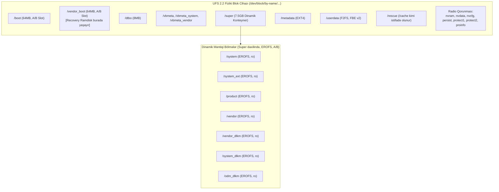

# Xiaomi Redmi Note 13 Pro 4G / POCO M6 Pro (`emerald`) Recovery Dərin Texniki Bələdçisi və Ensiklopedik Bilik Bazası

> [!IMPORTANT]
> Bu sənəd **`theilgar/device_xiaomi_emerald-recovery`** layihəsinin və onunla əlaqəli bütün ekosistemin (Kernel, Vendor, LineageOS 24.0) tam texniki memarlığını, aparat təminatını, Boot Header Version 4 hibrid strukturunu, drayverlərini, təhlükəsizlik modelini və buraxılış təkamülünü əks etdirən əsas istinad mənbəyidir. Yeni və növbəti bütün sessiyalarda bu fayl cihaz üzərində hər hansı inkişaf, diaqnostika və bərpa üçün birbaşa istifadə olunmalıdır.

---

## 1. Layihənin Kimliyi, Cihaz Kodları və Aparat Spesifikasiyası

* **GitHub Repozitoriyası:** [theilgar/device_xiaomi_emerald-recovery](https://github.com/theilgar/device_xiaomi_emerald-recovery)
* **Maintainer:** `theilgar`
* **Layihə / ODM Kod Adı:** Huaqin ODM Project **`N6`**
* **Cihaz Kod Adları:** `emerald`, `emerald_global`
* **Model Nömrələri:**
  * `23117RA68G` — Xiaomi Redmi Note 13 Pro 4G
  * `2312FPCA6G` — POCO M6 Pro 4G
  * `2502FRA65G` — Redmi Note 14S
* **Recovery Əsası:** OrangeFox Recovery Project (`fox_12.1` manifesti / AOSP Android 12.1–14 nüvəsi)
* **Əməliyyat Sistemi Hədəfi:** HyperOS 1.0/3.0 & LineageOS 24.0 (Android 14/17, Linux 5.10 / 6.12 GKI)

### Ətraflı Aparat Təminatı Cədvəli

| Alt Sistem | Təchizatçı və Spesifikasiya | Texniki Qeydlər |
| :--- | :--- | :--- |
| **SoC (Çipset)** | MediaTek Helio G99 Ultra (`MT6789` / `MT8781`) | 6nm TSMC, 64-bit ARMv8.2-A |
| **CPU** | 8 Nüvəli Heterogen Klaster | 2x ARM Cortex-A76 @ 2.2 GHz (Big) + 6x ARM Cortex-A55 @ 2.0 GHz (Little) |
| **GPU** | ARM Mali-G57 MC2 | Valhall arxitekturası, Vulkan 1.3, OpenGL ES 3.2 |
| **DRAM** | 8GB / 12GB LPDDR4X | İkikanallı 16-bit şin, 4266 Mbps tezlik |
| **Daxili Yaddaş** | UFS 2.2 (`11270000.ufshci`) | Gear 3/Gear 4 HS, iki xətt (dual-lane), WriteBooster |
| **Displey** | 6.67" AMOLED FHD+ (1080 x 2400) | 120Hz yenilənmə, 1920Hz 12-bit PWM, 1300 nits pik parlaqlıq |
| **Toxunma (İkili)** | Goodix GT9916 & FocalTech FT3683G | Visionox və Huaxing (CSOT) panelləri üçün ikili sensor strategiyası |
| **Displey PMIC** | Richtek RT4831A I2C | AMOLED panel üçün $\pm 5.5\text{V}$ analoq qidalanma və bias enerjisi |
| **Əsas PMIC** | MediaTek MT6397, MT6358, MT6375 | PWRAP şini üzərindən AP ilə əlaqə |
| **Şarj & Nasos** | Southchip SC6601 & SC8541, Nuvolta NU2115 | 67W / 33W Mi Turbo Charge, SC8541 2:1 Charge Pump |
| **Batareya Qaz Sayğacı**| TI BQ28Z610 I2C & MT6358 kulum sayğacı | Yüksək dəqiqlikli empedans və cərəyan ölçülməsi |
| **Haptika (Vibro)** | Awinic AW8624 / AW8622x LRA Haptic | I2C `0x5A`, F0 rezonans ~208Hz, aktiv proqram əyləcləməsi |
| **Fənər (Flash)** | TI LM3643 Dual Flash LED & MT6789 Flash | I2C interfeysli ikiqat LED nəzarətçisi |

---

## 2. Boot Memarlığı, Partition Layout və Virtual A/B

### 2.1 Boot Header Version 4 və GKI
Android 12+ GKI və Boot Header Version 4 standartında cihaz **Non-recovery-as-boot** strukturundadır:
* Ənənəvi fiziki `recovery` bölməsi **yoxdur**.
* Recovery ramdiski birbaşa **`vendor_boot`** bölməsi daxilində yerləşir (`BOARD_USES_RECOVERY_AS_BOOT := false`, `BOARD_INCLUDE_RECOVERY_RAMDISK_IN_VENDOR_BOOT := true`, `FOX_VENDOR_BOOT_RECOVERY := 1`).
* Əsas `boot` bölməsi sırf Google Generic Kernel Image (GKI Linux 5.10 / 6.12) və boot imzasını daşıyır.
* Sıxılmış Virtual A/B (LZ4) dəstəklənir (`AB_OTA_UPDATER := true`, `FOX_VIRTUAL_AB_DEVICE := 1`).

### 2.2 MediaTek MT6789 Fiziki DRAM Xəritəsi və Offsetlər
```
0x00000000 ----------------------- Daxili SRAM və MMIO Periferiyası (0x10000000 sahəsi)
0x3fff8000 ----------------------- BOARD_KERNEL_BASE
0x40000000 ----------------------- BOARD_KERNEL_OFFSET (0x00008000) -> Linux Kernel DRAM Yüklənməsi
0x47c80000 ----------------------- BOARD_DTB_OFFSET / TAGS (0x07c88000) -> DTB Blob & Parametrlər
0x66f00000 ----------------------- BOARD_RAMDISK_OFFSET (0x26f08000) -> Ramdisk DRAM Yüklənməsi
```

### 2.3 Partisiya Ölçüləri və Dinamik Qrup Hesablaması
* `BOARD_BOOTIMAGE_PARTITION_SIZE := 67108864` (64 MiB)
* `BOARD_VENDOR_BOOTIMAGE_PARTITION_SIZE := 67108864` (64 MiB)
* `BOARD_DTBOIMG_PARTITION_SIZE := 8388608` (8 MiB)
* `BOARD_SUPER_PARTITION_SIZE := 7515144192` bayt (~7.5 GB / 7167 MiB)
* `BOARD_MTK_DYNAMIC_PARTITIONS_SIZE := 7510949888` bayt
* **LP Metadata üçün Ayrılmış Sahə:**
  $$7,515,144,192\text{ bayt} - 7,510,949,888\text{ bayt} = 4,194,304\text{ bayt } (4\text{ MiB})$$
  Bu 4 MiB sahə `super` bölməsinin başında və sonunda Logical Partition (LP) metadata cədvəlləri, ehtiyat nüsxələri və həndəsi blok düzülüşü üçün qorunur.

### 2.4 Bölmə Sxemi (`recovery.fstab` və `twrp.flags`)



* **Dinamik Məntiqi Bölmələr:** `system`, `system_ext`, `vendor`, `product`, `vendor_dlkm`, `system_dlkm`, `odm_dlkm` — hamısı sıxılmış, yüksək oxuma sürətinə malik **`erofs`** fayl sistemindədir.
* **Radio və IMEI Qorunması:** Bütün kalibrasiya və IMEI məlumatları (`nvram`, `nvdata`, `nvcfg`, `persist`, `protect1`, `protect2`, `proinfo`) `twrp.flags` daxilində `backup=1` təyin edilib.

---

## 3. Reverse Engineering: Hibrid `vendor_boot` və Bootloader Dual-Boot Mexanizmi

### 3.1 Standart OrangeFox Build-in Əsas Problemləri (`ofox_info.txt` Auditi)
Standart OrangeFox derlənməsi nəticəsində yaranan xam `vendor_boot.img` faylında aşağıdakı fatal qüsurlar var idi:
1. **`vendor_ramdisk00` (Platform Ramdisk) Cəmi 20 Bayt idi:** Hexdump `1f 8b 08 00 ...` göstərdi ki, bu sadəcə boş dummy gzip arxivdir. Real sistem açılışı üçün vacib olan 30MB-lıq platform ramdiski itmişdi.
2. **`vendor bootconfig size: 0`:** RCU və kernel parametrləri ötürülmürdü.
3. **Ofsetlər Səhv idi:** Köhnə legacy ofsetlər (`kernel 0x10008000`, `ramdisk 0x11000000`, `dtb 0x11f00000`) istifadə edilmişdi. MediaTek MT6789-da `0x10000000` ünvan sahəsi daxili MMIO registrləri olduğundan bootloader bu ünvanlara yazarkən dərhal **Bus Fault və Hardware Crash** verirdi.

### 3.2 `unpacked_ramdisk00` vs `unpacked_ramdisk01` Müqayisəsi

```
vendor_boot.img (Boot Header Version 4)
 ├── vendor_ramdisk00 (Type 0x1 - PLATFORM, ~30.4 MB):
 │    └── LineageOS 24.0 / Stock first_stage_ramdisk
 │         ├── lib/modules (30.1 MB): ufs-mediatek-mod.ko, mediatek_drm_v1.ko, pinctrl, clk, pmic
 │         ├── first_stage_ramdisk/init & fstab.mt6789
 │         └── sepolicy (1.4 MB)
 │
 └── vendor_ramdisk01 (Type 0x2 - RECOVERY, ~31.4 MB):
      └── OrangeFox Recovery Ramdisk (Legacy LZ4 0x184c2102)
           ├── twres/ (OrangeFox UI Resursları & Temalar)
           ├── FFiles/ (Bərpa və AVB yamalama skriptləri)
           ├── system/bin/ (twrp, adbd, toybox, toolbox, sgdisk, e2fsck)
           └── lib/modules (1.6 MB): gt9916.ko, ft3683g.ko, xiaomi.ko, haptic.ko, lm3643.ko
```

### 3.3 Little Kernel (LK) Açılış Şəbəkəsi və Dual-Boot
MediaTek Little Kernel (BL33) açılış anında `boot_mode` bayrağını yoxlayır:
* **Normal Açılış:** LK `vendor_ramdisk_table`-dən `ramdisk_type == 0x1` (`vendor_ramdisk00`) fraqmentini seçir, `boot.img`-dən oxunan GKI ramdiski ilə DRAM-da (`0x66f00000`) birləşdirir, DTB-ni `0x47c80000`-ə qoyur və Linux kernelə ötürür. Normal Android sistemi açılır.
* **Recovery Açılışı:** LK `ramdisk_type == 0x2` (`vendor_ramdisk01`, adı `recovery`) fraqmentini aktivləşdirir və OrangeFox GUI açılır.

### 3.4 Yekun 64MB Hibrid `vendor_boot` Yaddaş Xəritəsi (`verify_final`)

```
+-----------------------------------------------------------------------------------+
| Səhifə 0 (0x00000000 - 0x00001000): Header v4 (2128 bayt, 4KB-a pad olunub)      |
+-----------------------------------------------------------------------------------+
| Səhifələr 1 - 15112 (0x00001000 - 0x03B0A000): Birləşdirilmiş Ramdisklər         |
|  ├── vendor_ramdisk00 (Type 0x1, Platform): 30,414,026 bayt (~30.4 MB)            |
|  └── vendor_ramdisk01 (Type 0x2, Recovery): 31,484,478 bayt (~31.4 MB)            |
|      (Cəmi Ramdisk: 61,898,504 bayt, 15112 səhifə = 61,898,752 bayt, 248 bayt pad) |
+-----------------------------------------------------------------------------------+
| Səhifələr 15113 - 15162 (0x03B0A000 - 0x03B3C000): DTB Blob (Device Tree)         |
|  └── dtb.img: 201,662 bayt (50 səhifə = 204,800 bayt, 3,138 bayt pad)            |
+-----------------------------------------------------------------------------------+
| Səhifə 15163 (0x03B3C000 - 0x03B3D000): Vendor Ramdisk Table (2 x 108 bayt)      |
+-----------------------------------------------------------------------------------+
| Səhifə 15164 (0x03B3D000 - 0x03B3E000): Vendor Bootconfig (125 bayt)              |
+-----------------------------------------------------------------------------------+
| Yekun Xam Ölçü: 62,115,840 bayt (15,165 səhifə)                                   |
+-----------------------------------------------------------------------------------+
| 64MB Zero-Padding (0x03B3E000 - 0x04000000): 4,993,024 bayt təmiz sıfırlar (`0x00`)|
+-----------------------------------------------------------------------------------+
| Yekun İmic Ölçüsü: 67,108,864 bayt (Dəqiq 64 MiB / 16,384 səhifə)                 |
+-----------------------------------------------------------------------------------+
```

### 3.5 Bootconfig və Cmdline Rolları
* **`kernel.rcu_nocbs=all`:** RCU callback-lərini kthread-lərə ötürür, heterogen A76/A55 nüvələrində toxunma və ekran render axınında mikrosəkirləməni (jitter) tam ləğv edir.
* **`kernel.rcutree.enable_rcu_lazy=1`:** RCU callback-lərini gecikdirərək toplayır və CPU-nun dərin yuxu müddətini uzadır.
* **`kernel.rcupdate.rcu_cpu_stall_cputime=1`:** Nüvə ilişməsi zamanı dmesg loqlarına dəqiq telemetriya yazır.
* **`bootopt=64S3,32N2,64N2`:** MediaTek SoC EL3/ATF 64-bit, EL1/EL0 nüvə və tətbiqlərdə həm 64-bit, həm də 32-bit legacy (`armeabi-v7a`) binar dəstəyini təmin edir.
* **`androidboot.selinux=permissive`:** Bərpa mühitində SELinux AVC Denial xətalarını söndürür.
* **`truncate -s 67108864`:** UFS fiziki blok ölçüsü ilə fayl ölçüsünü bit-bə-bit bərabərləşdirərək MediaTek bootloader-in `sparse header error` və `partition size mismatch` xətası verməsinin qarşısını alır.

---

## 4. `lib/modules/` Altındakı 207 Kernel Modulunun Tam Təsnifatı

Recovery ramdisk daxilindəki 207 modula əsasən 8 əsas alt sistem formalaşır:

1. **Displey və DRM Panelləri (18 Modul):**
   * `mediatek_drm_v1.ko` (7.1 MB master DRM KMS)
   * `rt4831a_drv.ko` (Richtek AMOLED I2C PMIC, $\pm 5.5\text{V}$)
   * `panel-alpha-jdi-nt36672e-vdo-120hz-hfp.ko`, `panel-alpha-jdi-nt36672e-cphy-vdo.ko`
   * `panel-tianma-r66451-cmd-120hz.ko`, `panel-nt37801-cmd-fhd-10bit.ko`
   * `panel-samsung-s68fc01-vdo-aod.ko`, `panel-truly-td4330-cmd.ko`
   * `panel-n6-41-02-0b-dsc-vdo.ko`, `panel-n6-42-0d-0a-dsc-vdo.ko` (Huaqin N6 OEM panelləri)
   * `mtk_panel_ext.ko`, `mtk_disp_notify.ko`, `drm_display_helper.ko`, `drm_dma_helper.ko`, `pwm-mtk-disp.ko`, `leds-mtk.ko`, `leds-mtk-disp.ko`, `leds-mtk-pwm.ko`
2. **Toxunma Sensorları və Giriş Hadisələri (11 Modul):**
   * `gt9916.ko` (Goodix GT9916, Visionox AMOLED üçün, 1 MHz SPI)
   * `ft3683g.ko` (FocalTech FT3683G, Huaxing/CSOT AMOLED üçün, 6 MHz SPI)
   * `xiaomi.ko` (Xiaomi Core Touch, `/dev/xiaomi-touch` və `/dev/touch`)
   * `touch_boost.ko`, `mtk_ioctl_touch_boost.ko` (Toxunma CPU boost)
   * `switch_class.ko`, `miev.ko`, `hqsys_pcba.ko`, `hqsysfs.ko`, `mtk-kpd.ko`, `mtk-pmic-keys.ko`
3. **Güc, Batareya, PMIC və Şarj (39 Modul):**
   * `mtk-pmic-wrap.ko` (PWRAP körpüsü)
   * `mt6397.ko`, `mt6358-regulator.ko`, `mt6375.ko`, `rt5133-regulator.ko`
   * `mtk_battery_manager.ko`, `mt6358_battery.ko`, `bq28z610.ko` (Fuel gauge)
   * `main_chg.ko`, `subpmic_charger.ko` (Southchip SC6601), `sc8541_charger.ko` (67W Charge Pump), `nu2115.ko`
   * `tcpc_class.ko`, `tcpc_sc660x.ko`, `tcpc_nu6601.ko`, `xm_adapter_class.ko`, `xm_pd_adapter.ko`
4. **UFS 2.2 Yaddaş Kontrolleri (8 Modul):**
   * `ufs-mediatek-mod.ko` (3.3 MB), `phy-mtk-ufs.ko` (M-PHY), `rpmb.ko`, `rpmb-mtk.ko`, `cqhci.ko`, `ufs-mediatek-dbg.ko`, `phy-generic.ko`, `blocktag.ko`
5. **Haptika və Vibrasiya (3 Modul):**
   * `haptic.ko` (Awinic AW86xx I2C `0x5A`, F0 ~208Hz), `fshaptic_o.ko`, `regulator-vibrator.ko`
6. **Fənər (3 Modul):**
   * `lm3643.ko` (TI Dual Flash LED), `flashlight.ko`, `flashlights-mt6789.ko`
7. **Saatlar, Enerji Domenləri və Şinlər (38 Modul):**
   * `clk-common.ko`, `clk-mt6789.ko` (17 ədəd CCF saat modulu), `mtk-scpsys.ko`, `mtk-dvfsrc.ko`, `mediatek-cpufreq-hw.ko`, `mtk_dramc.ko`, `mtk-smi.ko`, `mtk-cmdq-drv-ext.ko`
8. **Əlaqə, TEE, IPC və Diaqnostika (86 Modul):**
   * `pinctrl-mtk-v2.ko`, `pinctrl-mt6789.ko`, `i2c-mt65xx.ko`, `spi-mt65xx.ko`, `musb_hdrc.ko`, `mcDrvModule.ko` (Mitee TEE), `mtk_wdt.ko`, `zram.ko`, `zsmalloc.ko`

---

## 5. AVB 2.0, dm-verity və Fastbootd Memarlığı

### 5.1 Zəncirvari VBMeta Strukturu
```
/vbmeta (Root VBMeta, --flags 1)
 ├── Chained Descriptor (Rollback 2) ──► /vbmeta_system (system, system_ext, product, system_dlkm)
 └── Chained Descriptor (Rollback 4) ──► /vbmeta_vendor (vendor, vendor_dlkm)
```
* **OrangeFox AVB Yamalaması:** `OF_PATCH_AVB20 := 1`, `OF_USE_NEW_MAGISKBOOT := 1`. `vbmeta` başlığındakı `flags` sahəsinə `0x03` (`HASHTREE_DISABLED | VERIFICATION_DISABLED`) yazılır. Custom ROM yazılarkən `fstab`-dakı `avb=...` direktivləri silinir və EROFS bölmələri birbaşa `dm-linear` vasitəsilə mount olunur.

### 5.2 Bootloader Fastboot vs Fastbootd Rejimi
* **Bootloader Fastboot (LK):** Yalnız fiziki blokları tanıyır; `dm-linear` və `liblp` olmadığı üçün `fastboot flash system system.img` əmrində `Partition not found` xətası verir.
* **Recovery Fastbootd (`TW_INCLUDE_FASTBOOTD := true`):** Linux nüvəsi və `ufs-mediatek-mod.ko` üzərində işləyən userspace daimonudur. `super` konteyneri daxilindəki dinamik məntiqi bölmələri (`mtk_dynamic_partitions`, 7.5GB) `liblp` ilə avtomatik ölçüləndirir (resize) və yazır.

---

## 6. Git Tarixçəsi və Release Təkamülü (`build-39` $\rightarrow$ `build-65`)

| Buraxılış / Commit | Problem və Qüsur | Tətbiq Olunmuş Mühəndislik Həlli |
| :--- | :--- | :--- |
| **`build-39/40`** (`5396a6f`) | Boot v4 ramdisk table çatışmazlığı | `mkbootimg.py` v4 və prebuilt DTB inteqrasiyası |
| **`build-41/42`** (`d64f130`) | Standart build stock ramdiski əzirdi | Hibrid `vendor_boot` strukturu yaradıldı (Platform + Recovery) |
| **`build-43/44`** (`d5297da`) | Kernel panic (`decoding-failed`), Qara ekran | Legacy LZ4 (`lz4 -9 -l -f`), modullar `early-init`-ə köçürüldü |
| **`build-49/50`** (`8cb85f2`) | Soong `namespace emerald does not exist` xətası| `sync_from_lineage.sh` yazıldı; repolar xaricdən sinxronlaşdırıldı |
| **`build-51/52`** (`60b0557`) | CI runner-lərində resurs toqquşması | Concurrency qrupu təyin edildi (tək aktiv iş axını) |
| **`build-53`** (`3eaa1a2`) | Mavi rəng təhrifi, Fstab açılmırdı | `BGRA_8888` piksel formatı, Fastbootd aktivləşdirildi, ofsetlər düzəldildi |
| **Commit `e6954e7`** | Recovery loop çöküşü (`Unable to open fstab`) | Kökdən fiziki `/etc` silindi, AOSP `/system/etc` keçidi bərpa edildi |
| **Commit `afad30b`** | Parlaqlıq 50%-də qalırdı, Vibro işləmirdi | `TW_MAX_BRIGHTNESS := 4095`, `minuitwrp_awinic_haptics.patch` |
| **Commit `5d65e4d`** | **Keystore2 Futex Deadlock (Açılış donması)** | In-recovery crypto (`TW_INCLUDE_CRYPTO`) və `boot-hal` söndürüldü |
| **`build-65`** (`42d6728`) | UI kəkələməsi (20-30 FPS), sensor gecikməsi | **DRM Atomic Nonblocking Flip (60 FPS)**, CPU `performance`, cpuidle `teo` |
| **Commit `2e92dad`** | LK bootloader ölçü xətası verirdi | `truncate -s 67108864` ilə 64MB dəqiq padding tətbiq edildi |
| **UI Fix (2026)** | İkiqat şaquli miqyaslama (1.25x), navbar itirdi, Cream fon | `ui.xml`/`splash.xml` 1080x2400-ə keçirildi, `navbar_disable=0`, defolt AMOLED Black bərpa edildi, `OF_STATUS_H := 104`, `OF_HIDE_NOTCH := 1` |
| **RamDll Müqayisəsi** | `modules.dep`/`modules.load.recovery` və GSI açarları çatışmırdı | `modules.*` asılılıq cədvəlləri əlavə edildi, `BOARD_MOVE_GSI_AVB_KEYS_TO_VENDOR_BOOT := true` tətbiq olundu |

---

## 7. RamDll ilə Müqayisəli Analiz (RamDll/emerald-ota `clean-2.17` vs OrangeFox)

RamDll-in `emerald-lineage-24.0-clean-2.17-images-tools.zip` paketindəki `images/vendor_boot.img` faylı dekompilyasiya edildi:

| Komponent / Parametr | RamDll (`LineageOS 24.0`) | Bizim Layihə (`OrangeFox Recovery`) | Vəziyyət / Nəticə |
| :--- | :--- | :--- | :--- |
| **Boot Header Versiyası** | Header v4 (Pagesize: 4096) | Header v4 (Pagesize: 4096) | **Tam eynidir** |
| **DRAM Yükləmə Ofsetləri** | Kernel: `0x40000000`, Ramdisk: `0x66f00000`, DTB: `0x47c80000` | Kernel: `0x40000000`, Ramdisk: `0x66f00000`, DTB: `0x47c80000` | **Tam eynidir** |
| **Fiziki Partisiya Həcmi** | `67,108,864` bayt (64 MiB) | `67,108,864` bayt (64 MiB) | **Tam eynidir** |
| **DTB Blob (`dtb.img`)** | 201,662 bayt (MediaTek MT6789) | 201,662 bayt (MediaTek MT6789) | **Binar səviyyədə 100% eynidir** |
| **Bootconfig Parametrləri** | `rcu_nocbs=all`, `enable_rcu_lazy=1`, `rcu_cpu_stall_cputime=1` | `rcu_nocbs=all`, `enable_rcu_lazy=1`, `rcu_cpu_stall_cputime=1` | **Tam eynidir** |
| **Fraqment 1 (Platform)** | LineageOS 24.0 Platform Ramdisk (~14.8MB LZ4) | LineageOS 24.0 Platform Ramdisk (~30.4MB LZ4) | Hər ikisində tam UFS və hardware drayverləri var |
| **Modul Asılılıq Cədvəlləri**| `modules.dep`, `modules.load.recovery`, `modules.alias` var idi | Əvvəl yox idi $\rightarrow$ **RamDll-dən gətirildi və əlavə edildi!** | **Düzəldildi** |
| **GSI AVB Açarları** | `BOARD_MOVE_GSI_AVB_KEYS_TO_VENDOR_BOOT := true` | Əvvəl yox idi $\rightarrow$ **`BoardConfig.mk`-ya əlavə edildi!** | **Düzəldildi** |
| **Fraqment 2 (Recovery)** | Sadə AOSP LineageOS Recovery (məhdud funksiya) | Zəngin **OrangeFox GUI** (AMOLED Black, 60 FPS, Backup/Restore) | **OrangeFox daha üstündür** |
| **SELinux Modu** | Enforcing (`androidboot.selinux` cmdline-da yoxdur) | `androidboot.selinux=permissive` (Custom Recovery üçün zəruri) | Hər layihənin öz təyinatına uyğundur |

---

## 7. Cihaza Yazılma və Fastboot Təlimatı

> [!CAUTION]
> **KRİTİK TƏLƏB — YALNIZ 64MB VERSİYA YAZILA BİLƏR:**  
> Xiaomi `emerald` cihazının `vendor_boot` fiziki bölməsi dəqiq **`67,108,864` bayt (64 MiB)** təşkil edir.  
> Unpadded (tamamlanmamış, ~59-62MB) olan heç bir imic faylını telefona yazmaq **MÜMKÜN DEYİL** — MediaTek LK (Little Kernel) bootloader dərhal `FAILED (remote: 'size mismatch')` və ya sparse doğrulama xətası verərək yazılmanı rədd edir.  
> Build prosesində yaranan bütün imiclər mütləq `truncate -s 67108864` ilə 64MB-a tamamlanmalıdır. Telefona yalnız **`vendor_boot_64mb.img`** (və ya 64MB-a truncate edilmiş `vendor_boot.img`) yazılmalıdır!

```bash
# 1. Həmişə 64MB Padded vendor_boot imicini flash edin:
fastboot flash vendor_boot vendor_boot_64mb.img

# Və ya 64MB-a truncate edilmiş vendor_boot.img:
fastboot flash vendor_boot vendor_boot.img

# 2. Virtual A/B Slotları üzrə fərdi yazılma (hər iki slota yalnız 64MB fayl):
fastboot flash vendor_boot_a vendor_boot_64mb.img
fastboot flash vendor_boot_b vendor_boot_64mb.img

# 3. OrangeFox Recovery-yə daxil olun:
fastboot reboot recovery
```

---

## 8. Gələcək Sessiyalar Üçün Qızıl Qaydalar (Agent Qaydaları)

1. **YALNIZ 64MB İMİC İSTİFADƏ EDİLMƏLİDİR:** `vendor_boot` üçün yalnız `truncate -s 67108864` ilə 64MB-a (67,108,864 bayt) tamamlanmış `vendor_boot_64mb.img` telefona yazıla bilər. Digər unpadded versiyalar bootloader tərəfindən rədd edilir.
2. Cihaz **Boot Header Version 4** və **Non-recovery-as-boot** arxitekturasındadır; recovery **`vendor_boot`** daxilindədir. Heç vaxt `fastboot flash recovery recovery.img` əmrini təkbaşına verməyin, həmişə `fastboot flash vendor_boot vendor_boot_64mb.img` istifadə edilməlidir.
3. **FBE v2 Decryption Qaydası:** Əgər `TW_INCLUDE_CRYPTO := true` və `TW_INCLUDE_CRYPTO_FBE := true` aktivdirsə, `TW_USE_FSCRYPT_POLICY := 2`, `TW_INCLUDE_FBE_METADATA_DECRYPT := true`, `recovery.fstab`-da `fileencryption=...` və `keydirectory=/metadata/vold/metadata_encryption`, `init.recovery.mt6789.rc`-də isə TEE drayverləri (`sec.ko`, `mcDrvModule.ko`, `mitee.ko`) və `/tmp/misc/keystore` qovluğu mütləq təmin edilməlidir. Əks halda keystore2 futex kilidinə düşə bilər.
4. Toxunma sensoru araşdırılarkən həm **Goodix GT9916**, həm də **FocalTech FT3683G** mikrokodlarının (`.bin`, `.csv`, `.ini`) və drayverlərinin (`xiaomi.ko`, `switch_class.ko`) yerində olduğunu yoxlayın.
5. Haptika sistemində `minuitwrp_awinic_haptics.patch` və `/sys/class/leds/awinic_vibrator/vibrator/activate` qovşağı əsas götürülməlidir.
6. Yeni kernel modulları və ya DTB yeniləndikdə mütləq `scripts/sync_from_lineage.sh` skriptindən istifadə olunmalıdır.
7. **ORANGEFOX İNTERFEYS (UI) QAYDASI:** `ui.xml` və `splash.xml` fayllarında rezolyusiya mütləq `1080x2400` olmalıdır. Əks halda `recovery` binarı $2400/1920 = 1.25\times$ ikiqat miqyaslama tətbiq edərək alt naviqasiya panelini və əsas tabları ekranın alt sərhədindən 420px aşağıya (görünməz sahəyə) atır. `OF_STATUS_H := 104`, `OF_HIDE_NOTCH := 1` və `navbar_disable := 0` təyin edilməlidir.
8. **OTA & Preloader Simvolik Keçidləri:** Rəsmi HyperOS OTA ZIP-lərinin flash edilə bilməsi üçün `init.recovery.mt6789.rc`-də `lk1 -> bootloader`, `lk1 -> bootloader1`, `preloader_raw_a -> preloader_a` keçidləri mütləq olmalıdır.
9. **FBE Fayl Adları Şifrələməsi (`system.prop`):** MediaTek MT6789 FBE v2 üçün `ro.crypto.volume.filenames_mode=aes-256-cts` təyin edilməlidir, əks halda `/data/media/0` fayl adları şifrəli simvollar kimi qalır.
10. **Dinamik Bölmələr (`odm_dlkm`):** `super` partitsiyasında ODM kernel modulları üçün `odm_dlkm` bölməsi `BoardConfig.mk` və `recovery.fstab`-da tanınmalıdır.
11. **Fənər (Flashlight) və OrangeFox Sysfs Körpüsü:** OrangeFox C++ mühərriki (`GUIAction::flashlightImpl`) fənəri idarə edərkən mütləq `path_one + "/brightness"` faylını axtarır. MediaTek MT6789-da isə LED nəzarəti platforma drayveri (`flashlights_mt6789`) tərəfindən birbaşa `/sys/devices/platform/flashlights_mt6789/mt6789_flash` faylı vasitəsilə ('1'/'0') təmin edilir və `hq_led_class.ko` modulundan asılıdır. Buna görə də `hq_led_class.ko` əvvəlcədən yüklənməli, ramdiskdə `/flashlight/brightness` simvolik körpüsü yaradılmalı və `BoardConfig.mk`-da `OF_FL_PATH1 := /flashlight` təyin edilməlidir.
